# 👋 Hi, I'm Naveen G

### Software Developer (Engineering – Cloud & Infrastructure) at Valtech | Bangalore, India

🚀 DevOps • Cloud Engineer | AWS | CI/CD | Kubernetes | Terraform

---

Software Developer with **3+ years of experience in DevOps**, working on cloud and infrastructure at Valtech. I work with **CI/CD pipelines, Terraform, Kubernetes, AWS, Docker and Ansible**.

---

## 🧰 Tech Stack

---

## 🔧 What I Do
- 🛠️ Automate AWS infrastructure provisioning with Terraform and Ansible across dev, QA, pre-prod and prod environments
- 🚀 Design and maintain Jenkins CI/CD pipelines for reliable, automated delivery
- 🐳 Deploy containerized microservices on Kubernetes (Amazon EKS) using Docker and Helm
- 📈 Build observability with Prometheus, Grafana, ELK Stack and CloudWatch for monitoring and logging
- 🐧 Troubleshoot Linux (RHEL) servers and AWS networking (DNS, load balancers, security groups)
- 🎫 Handle incidents and coordinate with cross-functional teams using ServiceNow and Jira

---

## 💼 Career Snapshot
🏢 **Valtech, Bangalore** – *Associate Software Developer (Engineering – Cloud & Infrastructure)* (Aug 2023 – Present)

- Cut manual deployment effort by **70%** by automating infrastructure with Terraform and Ansible
- Reduced MTTR by **35%** with centralized monitoring and logging pipelines
- Improved pipeline performance and deployment reliability by optimizing Jenkins build stages, artifact management and environment configs

🎓 **IIIT Ongole** – *B.Tech, Mechanical Engineering* (2022)

---

## 📂 Projects

### ☁️ Solaris to AWS Cloud Migration
**Stack:** AWS (EC2, ASG, IAM, Security Groups), RHEL 9, Packer, Terraform, Java (Maven), Grafana
- Migrated ~800 on-prem Solaris servers running a Java financial data application to AWS RHEL 9 in 3–4 months
- Standardized golden AMIs with Packer (RHEL 9 base, JDK, monitoring agent)
- Built reusable Terraform modules (AMI lookup, EC2/ASG, security groups, IAM roles)
- Achieved **15–20% cost optimization** through right-sizing, Savings Plans, gp3 volumes and AMI/snapshot cleanup

### 🛒 RoboShop (Personal Projects)
- [**roboshop-docker**](https://github.com/Gangineninaveen123/roboshop-docker): multi-container app run with Docker Compose on a custom network
- [**roboshop-infra-dev-terraform**](https://github.com/Gangineninaveen123/roboshop-infra-dev-terraform): Terraform code for dev infrastructure on AWS
- [**ansible-roboshop-roles-tf**](https://github.com/Gangineninaveen123/ansible-roboshop-roles-tf): Ansible roles for RoboShop servers provisioned with Terraform

---

## 📊 GitHub Stats

 

Thanks for visiting!
