# 👋 Hi, I'm Naveen G

### Software Developer (Engineering – Cloud &Infrastructure) at Valtech | Bangalore, India

🚀 DevOps • Cloud Engineer | AWS | CI/CD | Kubernetes | Terraform

---

Software Developer with **3+ years of experience in DevOps**, working on cloud and infrastructure at Valtech. I work with **CI/CD pipelines, Terraform, Kubernetes, AWS, Docker and Ansible**.

---

## 🧰 Tech Stack

---

## 🔧 What I Do
- 🛠️ Build and manage cloud infrastructure on AWS using Terraform
- 🚀 Design and maintain CI/CD pipelines for automated build and deployment
- 🐳 Containerize applications with Docker and run them on Kubernetes
- 🔐 Apply DevSecOps practices to keep delivery secure
- 🤖 Automate repetitive tasks using Shell scripting and Ansible

---

## 💼 Career Snapshot
🏢 **Valtech, Bangalore** – *Associate Software Developer (Engineering – Cloud &Infrastructure)* (Aug 2023 – Present)

Working on cloud and infrastructure engineering with a focus on CI/CD, infrastructure as code and DevSecOps.

🎓 **IIIT Ongole** – *B.Tech, Mechanical Engineering* (2022)

---

## 📂 Projects
- **RoboShop**: multi-container app run with Docker Compose on a custom network

---

## 📊 GitHub Stats

Thanks for visiting!
