# 👋 Hi, I'm Naveen G

### DevOps Engineer | Software Developer at Valtech (Engineering – Cloud & Infrastructure) | Bangalore, India

🚀 AWS • Kubernetes • Terraform • Jenkins • CI/CD

---

Software Developer with **3+ years of experience in DevOps**, working on cloud and infrastructure at Valtech. I build and operate **CI/CD pipelines, Kubernetes (Amazon EKS) workloads and AWS infrastructure** using **Terraform, Ansible, Jenkins and Docker**.

---

## 🧰 Tech Stack

---

## 🔧 What I Do
- 🛠️ Automate AWS infrastructure provisioning with Terraform and Ansible across dev, QA, pre-prod and prod environments
- 🚀 Design and maintain Jenkins CI/CD pipelines for reliable, automated delivery
- 🐳 Deploy containerized microservices on Kubernetes (Amazon EKS) using Docker and Helm
- 🔵🟢 Implement Blue-Green deployments for zero-downtime releases with quick rollback
- 📈 Build observability with Prometheus, Grafana, ELK Stack and CloudWatch for monitoring and logging
- 🐧 Troubleshoot Linux (RHEL) servers and AWS networking (DNS, load balancers, security groups)
- 🎫 Handle incidents and coordinate with cross-functional teams using ServiceNow and Jira

---

## 💼 Career Snapshot
🏢 **Valtech, Bangalore** – *Associate Software Developer (Engineering – Cloud & Infrastructure)* (May 2023 – Present)

- Cut manual deployment effort by **70%** by automating infrastructure with Terraform and Ansible across 4 environments
- Deployed microservices on Amazon EKS with Docker and Helm, using Blue-Green deployments for zero-downtime releases
- Improved pipeline performance and deployment reliability by optimizing Jenkins build stages and artifact management
- Reduced MTTR by **35%** with centralized monitoring and logging (Prometheus, Grafana, ELK, CloudWatch)

🎓 **IIIT Ongole** – *B.Tech, Mechanical Engineering* (2022) | CGPA 8.3 / 10

---

## 📂 Personal Projects

### 🛒 RoboShop
- [**roboshop-docker**](https://github.com/Gangineninaveen123/roboshop-docker): multi-container app run with Docker Compose on a custom bridge network, images pushed to Docker Hub
- [**roboshop-infra-dev-terraform**](https://github.com/Gangineninaveen123/roboshop-infra-dev-terraform): Terraform code for dev infrastructure on AWS
- [**ansible-roboshop-roles-tf**](https://github.com/Gangineninaveen123/ansible-roboshop-roles-tf): Ansible roles for RoboShop servers provisioned with Terraform

---

## 📊 GitHub Stats

 

Thanks for visiting!
